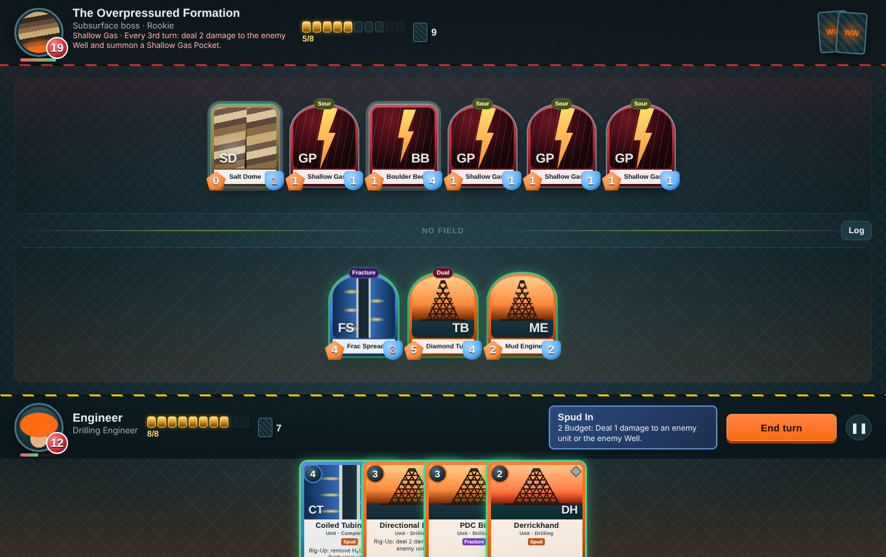
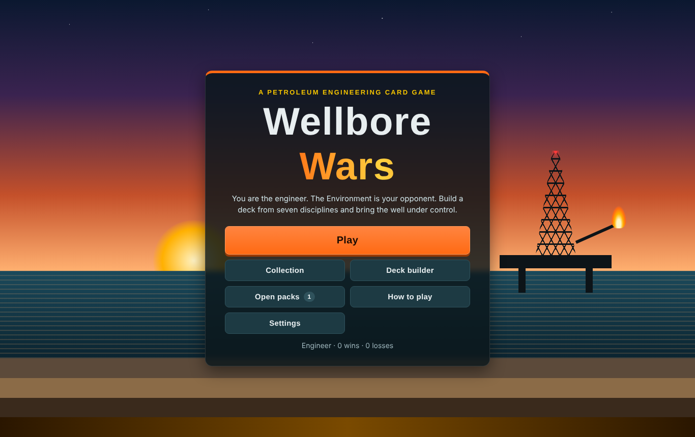
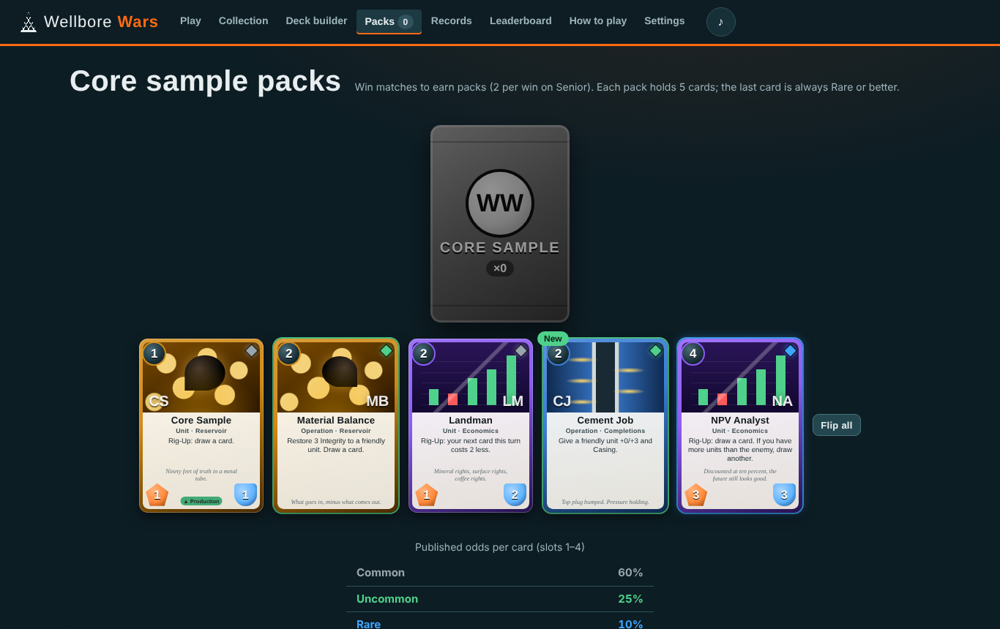
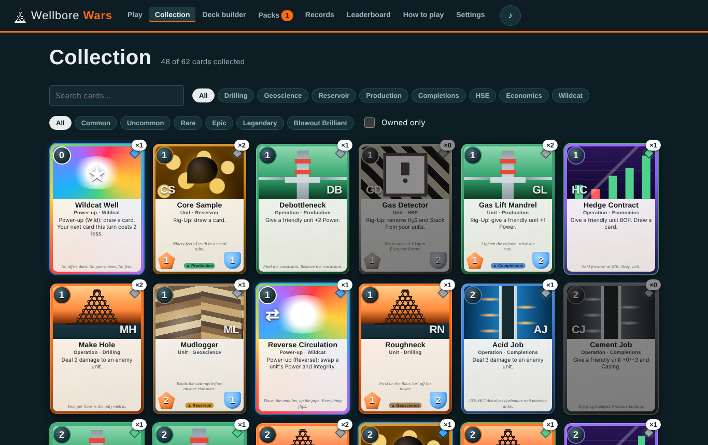
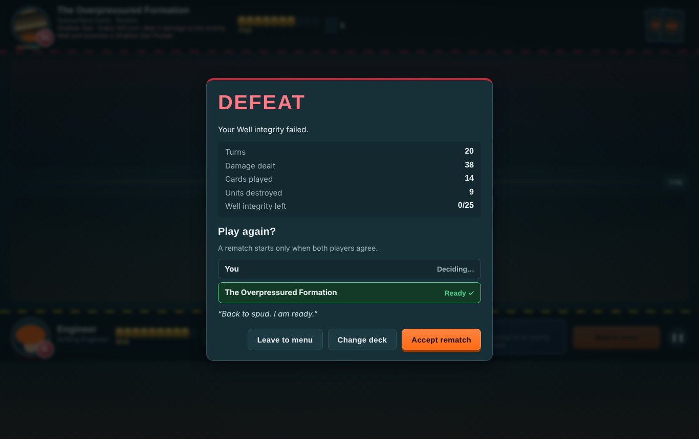

# Wellbore Wars

**A 1v1 petroleum engineering trading card game. You are the engineer. The Environment is your opponent.**

[](https://github.com/KendrewFlor/wellbore-wars/actions/workflows/ci.yml)
[](https://github.com/KendrewFlor/wellbore-wars/actions/workflows/codeql.yml)


### ▶ [Play it in your browser](https://kendrewflor.github.io/wellbore-wars/)



Build a 20-card deck from seven petroleum engineering disciplines, then take on three bosses: an overpressured formation, a typhoon season and an oil-price crash. It plays like Hearthstone or Legends of Runeterra, with UNO-style power-ups that reverse, skip and dump junk into your opponent's hand.

## Features

- **62 collectible cards** across Drilling, Geoscience, Reservoir, Production, Completions, HSE and Economics, plus Wildcat power-ups. There are 14 more hazard cards that only the Environment plays.
- **Six rarities:** Common, Uncommon, Rare, Epic, Legendary and the ultra-rare **Blowout Brilliant**, with an animated oil-slick foil.
- **A colour per discipline**, matched to the field: hi-vis orange for Drilling, crude amber for Reservoir, separator green for Production, steel blue for Completions, safety yellow and hazard stripes for HSE.
- **Every card's art is drawn in CSS:** derricks, faulted strata, oil-filled sand grains, Christmas-tree valves, perforation tunnels and candlestick charts. There are no image files.
- **A discipline wheel.** Drilling beats Geoscience, which beats Reservoir, then Production, then Completions, which beats Drilling again. Each win on the wheel adds +1 damage.
- **Eight keywords taken from the oilfield:** Spud, Casing, BOP, Fracture, Recovery, Sour (H₂S), Waterflood and Dual.
- **UNO-style power-ups:** Reverse Circulation (swap a unit's stats), Wait on Weather (skip their attacks), Pit Gain +2 (junk Cuttings into their hand) and Wildcat Well (wild draw and discount).
- **Three bosses, each with its own deck, Commander power, passive and taunts:**

  | Boss | Theme |
  |---|---|
  | The Overpressured Formation | Shallow gas and boulder beds |
  | Typhoon Season | Squalls and rogue waves |
  | Market Crash | Taxes your Budget and builds walls |

- **Three difficulties.** Rookie, Engineer and Senior change the AI's mistakes, the boss's Well size and your pack rewards.
- **Three commanders** with once-per-turn powers: Drilling, Reservoir and Production Engineer.
- **Fields** change the rules for both players: HPHT Well, Deepwater Field, Shale Play and Hurricane Alley.
- **Progression.** Win packs, open them with a shake-and-flip reveal (published odds; the 5th card is always Rare or better), build custom decks with a cost curve, earn 12 achievements and track per-boss records.
- **Play Again by mutual consent.** After a match both sides must agree to a rematch, and it starts only when both are ready. **Leave** concedes and returns to the main menu.
- **Synthesised sound** for every action, plus generative background music. Everything is made in WebAudio and there are no audio files.
- **Animations:** card draws, units lunging into attacks, hits, deaths, floating damage numbers, turn banners, enemy card reveals and a full-screen flash for a Blowout Brilliant.
- **Responsive** from phones to wide screens. It also has keyboard shortcuts, a reduced-motion setting, screen-reader labels and a first-game tutorial.
- **Optional global leaderboard** on Cloud Firestore's free tier. The game works fully offline without it. See [setting it up](docs/FIREBASE_SETUP.md).

## How to play

1. Each side has a **Well** with 25 Integrity. Bring the enemy Well to 0.
2. Each turn you gain +1 max **Budget** (up to 10) and draw a card.
3. Click a glowing card to play it. If it needs a target, click one.
4. Click one of your ready units, then an enemy unit or the enemy Well, to attack. Combat is simultaneous.
5. Use your Commander power (2 Budget, once per turn), then press **End turn** (or the `E` key).

Right-click (or press and hold) any card to read it in full. The in-game **How to play** page covers every rule and keyword, and [docs/CARDS.md](docs/CARDS.md) lists every card.

## Screenshots

| Main menu | Opening a pack |
|---|---|
|  |  |
| **Collection** | **Rematch needs both players' consent** |
|  |  |

## What it's made of

| Part | Language | What it does |
|---|---|---|
| `index.html` | HTML | Structure of every screen, with a strict Content Security Policy |
| `css/` | CSS | **All visuals:** card frames, discipline art, rarity foils, the board, the rig scene, every animation and the responsive layout |
| `data/cards.json` | JSON | Every card, commander, starter deck and boss |
| `js/` | JavaScript | Rules engine, AI opponent, input, sound and the optional leaderboard |

JavaScript is kept to what a card game can't do without: applying the rules, running the AI turn, and saving progress. It builds plain elements with class names, and CSS does all the drawing. Card content is data, not code. The tests, local server and security scanner are excluded from GitHub's language statistics because they don't ship to the browser.

## Run it locally

You need [Node.js](https://nodejs.org) 22 or newer. There is nothing to install.

```sh
git config core.hooksPath .githooks   # keeps AI tools out of your commit authors
npm start                             # http://127.0.0.1:5173
npm run check                         # security scan + 30 tests
```

## Security

The repository is built to be safe to clone, open in an AI coding agent, and host publicly:

- **Zero dependencies and zero third-party code.** Firebase is reached through its REST API rather than its SDK.
- **A strict CSP** with no inline code. Network access is allowed only to the three Firebase hosts, and only from `js/cloud.js`.
- **A security scanner in CI** that checks for:
  - hidden Unicode (Trojan Source)
  - prompt-injection bait aimed at AI agents
  - committed agent config files (`CLAUDE.md`, `.mcp.json` …)
  - leaked secrets
  - unpinned GitHub Actions
  - unsafe DOM APIs
  - AI co-author trailers in commit history
- **GitHub Actions** pinned to commit SHAs with least-privilege tokens.
- **Firestore rules** that only let players write their own row, one result at a time, at most once every 30 seconds.

Details are in [SECURITY.md](SECURITY.md) and [docs/THREAT_MODEL.md](docs/THREAT_MODEL.md). If you use AI coding tools on this repo, read [docs/AI_TOOLING.md](docs/AI_TOOLING.md).

## License

[MIT](LICENSE) © 2026 Kendrew Flor S. Arrabe. Card names reference real oilfield equipment and practices; this is a game, not engineering guidance.
